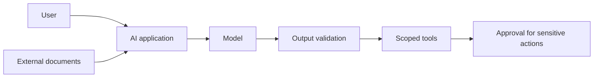

# 01 — מפת סיכוני OWASP

מודל הוא רק רכיב אחד. הסיכון יכול להתחיל בנתונים, לעבור דרך התשובה ולהסתיים בפעולה של כלי.

## עשרת הסיכונים — מהדורת 2025

| מזהה | שם רשמי |
| --- | --- |
| LLM01 | Prompt Injection |
| LLM02 | Sensitive Information Disclosure |
| LLM03 | Supply Chain |
| LLM04 | Data and Model Poisoning |
| LLM05 | Improper Output Handling |
| LLM06 | Excessive Agency |
| LLM07 | System Prompt Leakage |
| LLM08 | Vector and Embedding Weaknesses |
| LLM09 | Misinformation |
| LLM10 | Unbounded Consumption |

תרגיל: קחו עוזר שמסכם מסמכים ומכין טיוטות. סמנו מהיכן מגיע כל קלט, מי יכול לשנות אותו ואיזו פעולה יכולה להיגרם בעקבותיו. בחרו שני סיכונים רלוונטיים והציעו בקרה לכל אחד.

המספור הוא מזהה במסגרת, ולא דירוג כמותי של הסיכון אצלכם.

[מקור: OWASP, מהדורת 2025](https://genai.owasp.org/llm-top-10/)
