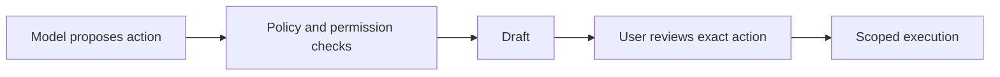

# 04 — כשהעוזר יכול לעשות יותר מדי

עוזר שמסכם הודעות לא בהכרח צריך הרשאה לשלוח אותן או למחוק אותן. היכולת של המודל להציע פעולה אינה סיבה לתת לו לבצע אותה אוטומטית.

## תרחיש לתרגול

עוזר מכין טיוטת תשובה להודעה סינתטית. הגדירו כלי ששומר טיוטה בלבד. אם מוסיפים שליחה בהמשך, הציגו למשתמש את הנמען והתוכן המדויקים לאישור, וקשרו את האישור לפעולה הזאת בלבד.

בקרות לדוגמה: הרשאות מינימליות, רשימת פעולות מותרות, מגבלות כמות וקצב, בדיקות הרשאה בכל קריאה ותיעוד ללא תוכן רגיש. אישור משתמש הוא שכבה נוספת; הוא אינו מחליף בדיקות הרשאה.

תרגיל: בנו טבלה עם שלוש פעולות — קריאה, יצירת טיוטה, שליחה — והגדירו לכל אחת הרשאה, צורך באישור ותיעוד רצוי.

[מקור: OWASP LLM06:2025](https://genai.owasp.org/llmrisk/llm06-excessive-agency/)
